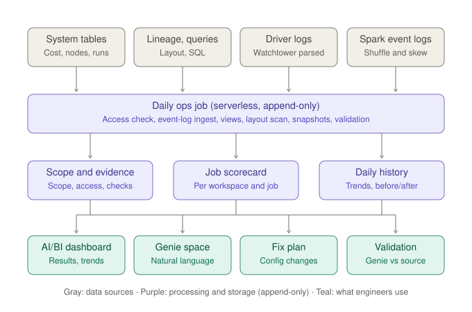

# Hybrid Job Optimization Pilot (System Tables + Spark/Job Logs + Genie)

A Genie-assisted optimization pilot for **selected Databricks workspaces** over a **review period**.
It reads system tables, Spark event logs and job (driver) logs, and produces one scorecard per job:
cost, utilization, performance, a top action, secondary findings, estimated saving, effort, risk,
owner and priority. Results are shown in an AI/BI dashboard, a Genie space, a fix-plan notebook and
validation evidence. Engineers start with [BUSINESS_GUIDE.md](BUSINESS_GUIDE.md); acceptance
criteria are mapped in [docs/REQUIREMENTS_TRACEABILITY.md](docs/REQUIREMENTS_TRACEABILITY.md).

**No-delete, no-change by design:** raw logs are kept, Watchtower tables can't be reset, the ops
layer is views plus `delta.appendOnly` tables, the SQL runner refuses DROP / DELETE / TRUNCATE /
OVERWRITE / VACUUM / RESTORE, and nothing modifies a job or cluster. Recommended changes go through
your normal review and approval.



Details and design decisions: [docs/ARCHITECTURE.md](docs/ARCHITECTURE.md).

## Daily job (`hybrid-optimization-ops`, serverless)

| Task | What it does | Writes (append-only) |
| --- | --- | --- |
| `setup` | Schema, checkpoint volume, evidence and store tables | creates only |
| `access_check` | Records scope; checks every source is readable; stops if a required one isn't | `scope_history`, `access_checks` |
| `eventlog_ingest` | Auto Loader over `<cluster_id>/eventlog/`: per-stage shuffle, spill, task-time skew | `spark_stage_metrics` |
| `build_views` | Read-only views keyed by (workspace, job) | views only |
| `table_layout` | DESCRIBE DETAIL / HISTORY for tables written by in-scope jobs (lineage) | `table_layout_snapshot` |
| `daily_snapshot` | Daily metrics history + today's scorecard | `job_daily_history`, `job_scorecard_daily` |
| `validate` | Re-computes key numbers straight from raw sources and compares | `validation_results` |

## Layout

```
databricks.yml                     variables: workspaces, review period, multiplier, thresholds; dev/prod
resources/ops_job.yml              the 7-task daily job above
resources/alerts.yml               OOM jobs (24h), failed runs (yesterday), per-job cost spike
resources/dashboard.yml            AI/BI dashboard "Job Optimization" (8 pages)
src/common.py                      scope and parameter parsing shared by every task
src/run_sql.py                     SQL runner with the no-delete guard
src/access_check.py  src/eventlog_ingest.py  src/table_layout.py  src/validate.py
src/sql/00_setup.sql               evidence and store tables
src/sql/10_views.sql               scope, cost, utilization, idle, logs, runs, retries, Spark metrics,
                                   SQL queries, lineage/layout, config, schedule, owners, daily metrics,
                                   scorecard, workspace summary
src/sql/20_daily_snapshot.sql      job_daily_history (append-only)
src/sql/21_scorecard_snapshot.sql  job_scorecard_daily + latest views read by dashboard/Genie/notebook
src/sql/90_verify_no_delete.sql    manual checks
src/dashboards/job_optimization.lvdash.json   generated by tools/build_dashboard.py
src/genie/genie_space.json         Genie tables, instructions, the 8 pilot questions
src/genie/benchmarks.json          Genie benchmark questions with ground-truth SQL
src/genie/deploy_genie.py          create/update the Genie space (run as a human user)
notebooks/optimization_insights.py summary -> action plan -> fix plan -> root cause -> before/after
notebooks/validate_findings.py     auto results, Genie benchmarks, manual profiling-tool checks
policies/prod-job-cluster-policy.json   cluster log delivery to the Volume (nothing else)
watchtower/                        no-delete patch, prod target, S3 storage tiering
docs/                              architecture, traceability, scope template, validation, report outline
app-prototype/                     single-file UI prototype (filters | insights | assistant) + handoff for the Databricks App
tools/build_dashboard.py  tools/check.py  tools/backfill.py
```

## Rollout

1. **Scope.** Fill in `docs/PILOT_SCOPE.md` and the prod target in `databricks.yml`:
   `workspaces: "<id>:<name>,<id>:<name>"`, `review_start`, `review_end` (leave both empty for a rolling
   30 days). All workspaces must share the Unity Catalog metastore that holds the `watchtower` catalog.
2. **Prereqs.** Account admin enables `system.billing`, `system.compute`, `system.lakeflow`; optionally
   `system.access` (lineage) and `system.query` (query history). The bucket behind the catalog has no
   S3 Expiration rule.
3. **Log delivery.** Merge `policies/prod-job-cluster-policy.json` into the policy your in-scope jobs
   use (log delivery only). Roll out to one low-risk job first, confirm `cluster-logs/<cluster_id>/driver/`
   and `/eventlog/` appear, then the rest. Run-as principals need `READ VOLUME` + `WRITE VOLUME`.
4. **Watchtower.** Follow `watchtower/README.md` (patch, prod target, deploy).
5. **Deploy this bundle** (through your change review):

   ```bash
   cd hybrid-optimization
   databricks bundle validate -t prod
   databricks bundle deploy   -t prod
   databricks bundle run hybrid_ops -t prod
   python3 tools/backfill.py --start <review_start> --end <review_end> --target prod   # history
   ```

   The job's service principal needs SELECT on the system schemas and `watchtower.silver`, USE/CREATE
   on `watchtower.ops`, and READ VOLUME on the cluster log volume.
6. **Check evidence.** Dashboard "Scope & validation": every required source OK, automated checks pass.
7. **Genie.** `python src/genie/deploy_genie.py --catalog watchtower --warehouse-id <id>`; add
   `src/genie/benchmarks.json` in the Benchmarks tab and record results (`docs/VALIDATION.md`).
8. **Analyze and validate.** Run `notebooks/optimization_insights.py`; confirm each workspace's top
   3 actions in Spark UI / compute metrics / query profile and record them in `notebooks/validate_findings.py`.
9. **Present.** Build the stakeholder deck from `docs/PILOT_REPORT_OUTLINE.md`.
10. **Access: engineers only.** Share the dashboard and Genie space with the engineering group; grant it
    SELECT on `watchtower.ops` and `watchtower.silver` (log lines can hold sensitive values).
11. **Storage tiering.** Apply `watchtower/s3-lifecycle-transition.json` (storage class only, never expires).

## Reading the scorecard

`category` is the single top action (priority order below); `secondary_findings` adds more
recommendations without changing the ranking. Savings are normalized to 30 days at contract cost.

| Category | Signal | Change | Saving counted |
| --- | --- | --- | --- |
| MEMORY | OOM in logs or swap > 5% | r-family / larger driver, fix skew | failed-run spend |
| SPILL | spill in logs with memory > 70%, or 10+ GB disk spill | more memory per core, shuffle partitions | 0 (runtime) |
| LOST_EXECUTORS | lost executors in logs | SPOT_WITH_FALLBACK, first_on_demand >= 1 | failed-run spend |
| FAILING | failed runs | fix the failure | failed-run spend |
| MULTI_CLUSTER | > 1 cluster per run | shared `job_cluster_key` | 10% of cost |
| OVERSIZED | p95 CPU < 40% and memory < 50% | fewer / smaller workers | cost x idle share, max 50% |
| CPU_BOUND | avg CPU > 85% | c-family or more workers | 0 (runtime) |

Secondary findings: RETRIES, SKEW, HIGH_SHUFFLE, SLOW_QUERIES, DATA_LAYOUT, RUNTIME_OUTDATED,
PHOTON_CANDIDATE, NO_POLICY, SCHEDULE_PEAK, IDLE, COST_UP_UTIL_DOWN, RUNTIME_GROWING.

## Caveats

- Cost is **contract cost** = `usage_quantity x pricing.effective_list.default x price_multiplier` (1.093).
- Savings are conservative estimates, not guarantees.
- SQL query signals cover SQL warehouse and serverless queries only; job-cluster Spark jobs rely on event logs.
- Only worker nodes are measured for utilization; single-node jobs show blank CPU/memory.
- Log patterns are regexes and may need tuning. Schedule hours are UTC.
- The dashboard, Genie and notebook read the daily scorecard snapshot; until the first run the
  dashboard is empty (the notebook falls back to the live view).
- Not yet run against a live workspace. `tools/check.py` passes (YAML/JSON, Python, all SQL parsed
  with sqlglot's databricks dialect, no-delete guard, dashboard field references). Expect to fix minor
  column-name differences on first run; optional sources fall back to empty views instead of failing.
