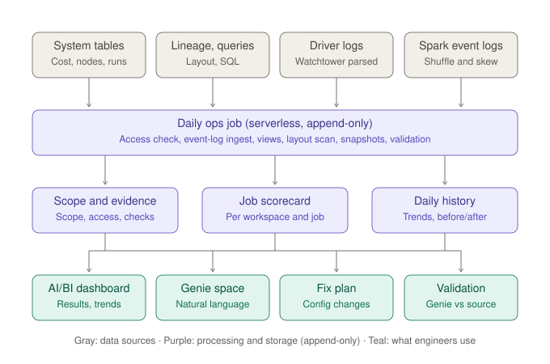

# Architecture



```mermaid
flowchart TD
  subgraph Sources
    ST[System tables<br/>billing, compute, lakeflow]
    LQ[Lineage + query history<br/>optional]
    DL[Driver logs<br/>Watchtower silver.logs]
    EL[Spark event logs<br/>cluster log delivery]
  end
  subgraph Daily ops job - serverless, append-only, no job or cluster changes
    A[access_check<br/>scope + access evidence] --> I[eventlog_ingest<br/>per-stage shuffle/spill/skew]
    A --> V[build_views<br/>per workspace + job]
    V --> L[table_layout<br/>files, size, OPTIMIZE]
    I --> S[daily_snapshot<br/>history + scorecard]
    L --> S
    S --> X[validate<br/>ops vs raw sources]
  end
  ST --> A
  LQ --> V
  DL --> V
  EL --> I
  S --> D[AI/BI dashboard]
  S --> G[Genie space]
  S --> N[Fix-plan notebook]
  X --> VN[Validation notebook<br/>+ Genie benchmarks + profiling checks]
```

## Design decisions (reviewed before building)

| Decision | Why |
| --- | --- |
| Every key is (workspace_id, job_id) | Job IDs are only unique within a workspace; the pilot covers several |
| Scope and access written to append-only tables each run | Acceptance criteria 1 and 2 need evidence, not just config |
| Validation re-computes numbers straight from system tables and logs | Checking Genie against our own views would be circular |
| Event logs summarized per stage per file, incrementally (Auto Loader) | Per-task rows would explode in size; active logs are re-delivered, so views keep the newest file version |
| One top action + secondary findings | New signals (Photon, runtime, schedule, policy, layout, retries, SQL) add recommendations without changing the ranking |
| Layout checked daily for tables written by in-scope jobs only (lineage, capped) | DESCRIBE DETAIL per table is too expensive to run per dashboard load |
| Optional sources get a fallback view | Query history, lineage and some cluster columns may not be enabled; the pipeline still runs |
| Dashboard/Genie read a daily scorecard snapshot | Fast and cheap; results are stable for the day they are presented |

## Known limits

- SQL query history covers SQL warehouse and serverless queries only; job-cluster Spark jobs rely on event logs.
- Watchtower parses driver logs only; executor-level detail comes from Spark event logs.
- Spark UI, compute metrics and query profile checks are manual and logged in `notebooks/validate_findings.py`.
- Schedule hotspots use UTC hours.
